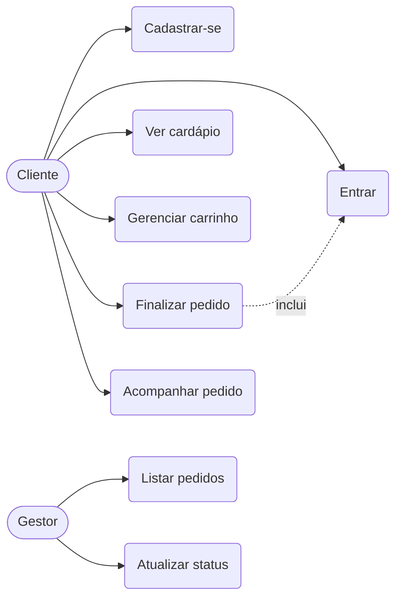
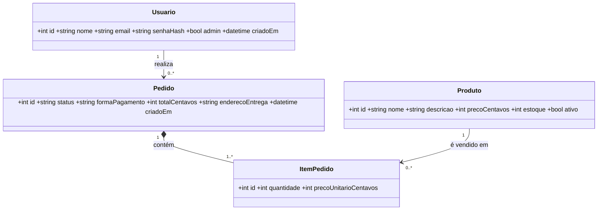
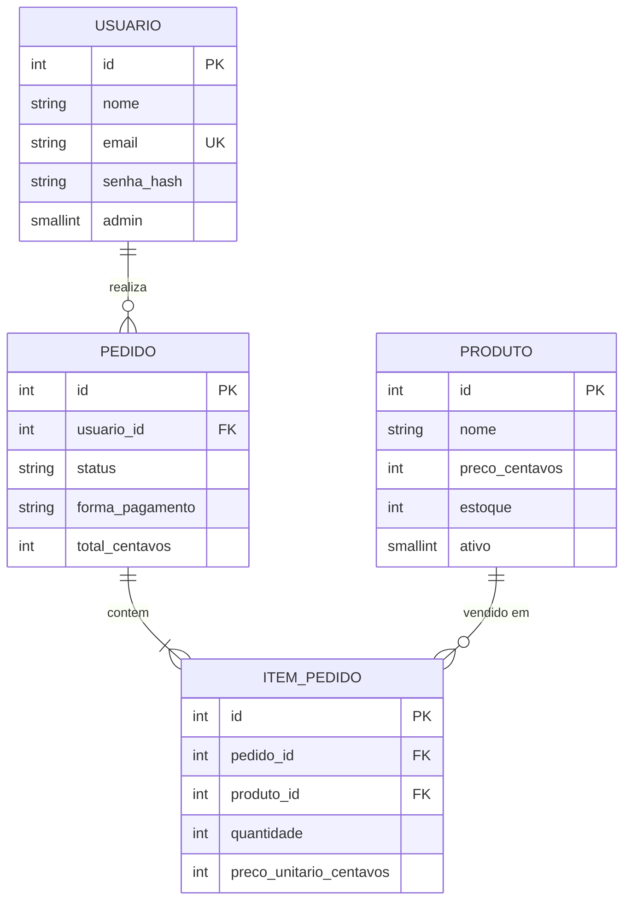
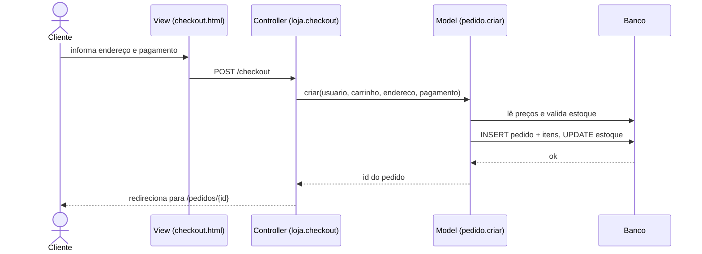

# Modelagem — Cupcakeria Gourmet

Cole cada bloco em https://mermaid.live (ou no Draw.io: Organizar → Inserir → Avançado → Mermaid) para exportar como imagem.

## Requisitos
**Funcionais:** RF01 cadastro e login · RF02 visualizar cardápio · RF03 gerenciar carrinho · RF04 finalizar pedido com endereço e pagamento · RF05 acompanhar status do pedido · RF06 gestor atualiza status dos pedidos · RF07 controle de estoque.
**Não funcionais:** RNF01 senhas com hash · RNF02 layout responsivo (celular) · RNF03 preço/total calculados no servidor · RNF04 arquitetura MVC.

## Casos de uso (descrição)
- **Cliente:** Cadastrar-se, Entrar, Ver cardápio, Gerenciar carrinho, Finalizar pedido (inclui Entrar), Acompanhar pedido.
- **Gestor (herda de Cliente):** Listar pedidos, Atualizar status.

## Diagrama de classes (persistência)

## Modelo entidade-relacionamento

## Diagrama de sequência — finalizar pedido

